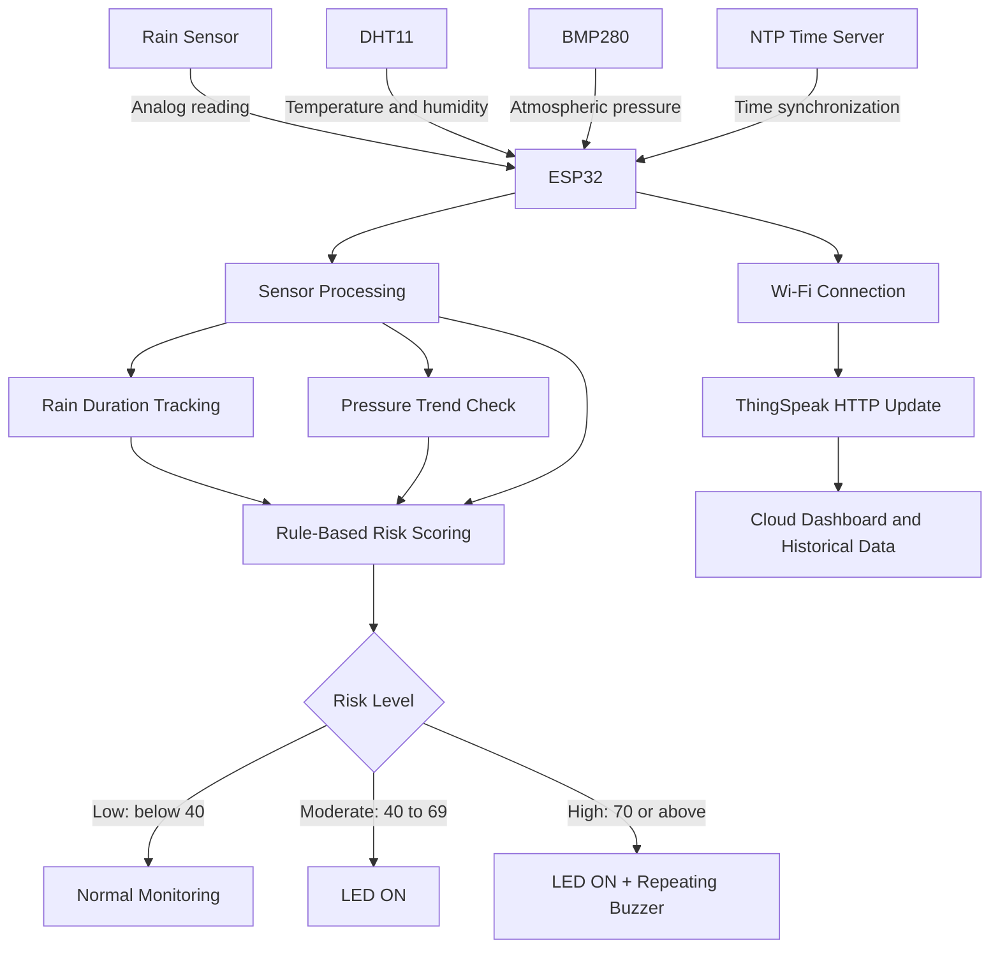

# AquaSentinel
An IoT-Based Flash Flood Risk Monitoring and Early-Warning System

AquaSentinel is an ESP32-based environmental monitoring prototype that combines rainfall detection, temperature, relative humidity, and atmospheric pressure measurements to estimate changing flood-risk conditions. It provides local alerts through an LED and buzzer and uploads sensor readings to ThingSpeak for remote monitoring and historical visualization.
Project scope: AquaSentinel is an experimental risk-indication prototype. Its score is a rule-based heuristic, not a scientifically validated flood forecast or an official emergency-warning system. Do not rely on it as the sole basis for safety decisions.

Table of Contents
- Overview
- Key Features
- System Architecture
- Hardware Requirements
- Software and Libraries
- Pin Configuration
- How It Works
- Flood-Risk Scoring
- ThingSpeak Field Mapping
- Setup and Installation
- Configuration
- Serial Monitor Output
- Calibration and Testing
- Limitations and Future Improvements
- Troubleshooting
- Repository Structure
- 安全 / Security Note
Overview
Flash floods can develop rapidly when intense or persistent rainfall combines with unfavorable atmospheric and local environmental conditions. AquaSentinel demonstrates a low-cost IoT approach to monitoring selected environmental indicators and communicating a simple risk level.

The ESP32 collects readings from:
- DHT11: ambient temperature and relative humidity.
- BMP280: atmospheric pressure.
- Rain sensor: analog indication of rainfall/wetness.
A rule-based algorithm combines these readings into a score from 0 to 100. The device indicates moderate or high risk locally and periodically sends measurements to a ThingSpeak channel.
Key Features
- Periodic environmental data collection.
- Averaged analog readings from the rain sensor to reduce short-term fluctuations.
- Rain-duration tracking.
- Rule-based flood-risk score using rain, humidity, pressure, and pressure trend.
- LED indication for moderate and high risk.
- Repeating buzzer alert for high risk.
- Wi-Fi connectivity and ThingSpeak cloud logging.
- NTP-based clock display using Indian Standard Time (UTC+05:30).
- Non-blocking interval scheduling for the main monitoring tasks, apart from short sensor sampling and network operations.
System Architecture
The diagram below shows the main data path from sensing to local alerts and cloud monitoring.

Architecture layers
Layer	Components	Responsibility
Sensing	Rain sensor, DHT11, BMP280	Collect environmental measurements
Edge processing	ESP32	Read, average, validate, and process sensor data
Risk assessment	Rule-based scoring logic	Calculate a 0–100 risk-indication score
Alerting	LED and buzzer	Provide immediate local status indication
Connectivity	Wi-Fi, HTTP, NTP	Synchronize time and transmit measurements
Cloud monitoring	ThingSpeak	Store and visualize uploaded measurements

Hardware Requirements
Component	Quantity	Purpose
ESP32 development board	1	Main controller and Wi-Fi connectivity
DHT11 sensor	1	Temperature and humidity
BMP280 sensor module	1	Atmospheric pressure
Analog rain sensor module	1	Rain/wetness indication
LED	1	Moderate/high-risk visual alert
Buzzer	1	High-risk audible alert
Breadboard and jumper wires	As required	Circuit connections
USB power supply	1	Power for the ESP32

Electrical note: Confirm the voltage requirements of each sensor module. ESP32 GPIO pins are not 5 V tolerant. Ensure that the rain sensor's analog output never exceeds the ESP32's permitted input voltage.
Software and Libraries
- Arduino IDE or a compatible Arduino build environment.
- ESP32 board support package.
- DHT sensor library
- Adafruit Unified Sensor
- Adafruit BMP280 Library
- Wire
- WiFi
- HTTPClient
- NTPClient
- WiFiUdp
Install the external libraries through the Arduino IDE Library Manager where available. Wire, WiFi, and HTTPClient are normally supplied by the relevant board/core packages.
Pin Configuration
Component	ESP32 pin	Interface
Rain sensor analog output	GPIO 34	ADC
Buzzer	GPIO 26	Digital output
DHT11 data	GPIO 13	Digital
LED	GPIO 32	Digital output
BMP280 SDA	GPIO 21	I²C
BMP280 SCL	GPIO 22	I²C

The BMP280 initialization attempts I²C address 0x76 and then 0x77. Use the address selected by your module's SDO configuration.
How It Works
1. Initialize hardware: Configure the GPIO pins, ADC resolution, DHT11, I²C bus, and BMP280.
2. Connect to Wi-Fi: The ESP32 attempts to connect for up to 20 seconds.
3. Synchronize time: NTP is used to display local time with a UTC+05:30 offset.
4. Read sensors: Every 30 seconds, the program averages ten rain-sensor ADC samples and reads temperature, humidity, and pressure.
5. Track rainfall duration: Consecutive rain detections are timed. The timer resets when rain is no longer detected.
6. Assess pressure trend: Pressure is compared with a previous reference reading at five-minute intervals.
7. Calculate risk score: The rule-based function combines the current measurements and trend indicator.
8. Activate local alerts: The LED turns on at moderate or high risk. The buzzer repeatedly beeps at high risk.
9. Upload data: Measurements are sent to ThingSpeak every 30 seconds, provided Wi-Fi is connected.
Flood-Risk Scoring
The current implementation uses the following rule-based score. The final score is constrained to the range 0–100.
Indicator	Condition	Points
Rain detected	Rain sensor crosses the configured threshold	+45
Rain duration	At least 30 seconds	+15
Rain duration	At least 2 minutes	+20 instead of +15
Rain duration	At least 5 minutes	+25 instead of +20
Relative humidity	At least 80%	+10
Relative humidity	At least 90%	+15 instead of +10
Atmospheric pressure	Below 1000 hPa	+10
Atmospheric pressure	Below 995 hPa	+15 instead of +10
Pressure trend	Pressure falls by more than 1.5 hPa between trend checks	+10

The duration, humidity, and pressure bands are mutually exclusive within their respective indicators; the program adds the highest applicable band, not every band.
Risk levels
Score	Risk indication	Device response
0–39	Low	LED OFF, buzzer OFF
40–69	Moderate	LED ON, buzzer OFF
70–100	High	LED ON, repeating buzzer

Important interpretation: These thresholds and weights are prototype settings. They should be calibrated using recorded local data and validated against suitable hydrological observations before making any claims about prediction accuracy.
ThingSpeak Field Mapping
The sketch sends an HTTP update to the ThingSpeak channel using the following mapping:
ThingSpeak field	Uploaded value
field1	Temperature (°C)
field2	Relative humidity (%)
field3	Atmospheric pressure (hPa)
field4	Rain sensor analog value
field5	Flood-risk score (0–100)
field6	Heat index (°C, as calculated by the DHT library)
field7	Rain status (1 = detected, 0 = not detected)

Create a ThingSpeak channel with these seven fields, then use its Write API Key in the device configuration. The channel dashboard can be used to visualize the uploaded time series.
Setup and Installation
1. Assemble the circuit using the pin configuration above.
2. Install the ESP32 board package and required Arduino libraries.
3. Create a ThingSpeak channel and enable seven fields.
4. Open the .ino sketch in Arduino IDE.
5. Replace the Wi-Fi and ThingSpeak placeholders in the configuration section with your own credentials. Do not publish real credentials.
6. Select the correct ESP32 board and serial port.
7. Upload the sketch to the ESP32.
8. Open Serial Monitor at 9600 baud.
9. Check that the BMP280 is detected and that Wi-Fi connects.
10. Observe sensor readings and test the LED/buzzer behavior under controlled conditions.
11. Confirm that new entries appear in the ThingSpeak channel.
Configuration
Update these values in the sketch before uploading:
const char* ssid = "YOUR_WIFI_SSID";
const char* password = "YOUR_WIFI_PASSWORD";

const char* server = "http://api.thingspeak.com/update";
String apiKey = "YOUR_THINGSPEAK_WRITE_API_KEY";
The main timing and threshold parameters are:
const unsigned long READ_INTERVAL = 30000;      // 30 seconds
const unsigned long UPLOAD_INTERVAL = 30000;    // 30 seconds
const unsigned long BEEP_INTERVAL = 1000;       // 1 second
const unsigned long PRESSURE_INTERVAL = 300000; // 5 minutes

const int RAIN_THRESHOLD = 800;
The rain threshold depends on the sensor, module, supply voltage, and installation. Test the dry and wet ADC values on your own hardware and adjust the threshold accordingly. The code currently treats values below the threshold as rain detected.
Serial Monitor Output
The Serial Monitor prints:
- Current NTP time.
- Rain detection status and raw rain-sensor value.
- Temperature, humidity, heat index, and pressure.
- Estimated rain duration.
- Flood-risk score and risk category.
- LED status.
- ThingSpeak upload result or HTTP error.
Calibration and Testing
Before relying on the prototype, perform controlled tests:
- Rain sensor: Record ADC values in dry, damp, and wet conditions. Select a threshold based on observed separation and sensor stability.
- DHT11: Compare readings with a trusted reference instrument. Account for its relatively limited accuracy and response speed.
- BMP280: Compare pressure readings with a trusted local reference. Confirm whether readings are station pressure or have been adjusted to sea-level pressure.
- Rain duration: Verify that the timer starts on detection and resets when the sensor returns to the dry state.
- Alerts: Test scores around 39/40 and 69/70 to verify LED and buzzer transitions.
- Connectivity: Test startup without Wi-Fi and recovery after a temporary disconnection.
- Cloud logging: Confirm field mapping, timestamps, and successful ThingSpeak entries.
Keep a test log containing sensor conditions, raw readings, calculated scores, and observed alert behavior.
Limitations and Future Improvements
Current limitations
- The risk score is a manually weighted heuristic, not a trained or validated flood-prediction model.
- A rain sensor measures local surface wetness and does not directly measure rainfall intensity or accumulated rainfall.
- DHT11 measurements have limited precision and are not a substitute for calibrated meteorological instruments.
- Atmospheric pressure alone cannot establish whether flooding will occur.
- The current sketch uses a single pressure-trend comparison and does not retain a rolling pressure history.
- Wi-Fi and HTTP requests can interrupt timely sensor processing while a connection is attempted.
- The device does not currently include water-level, river-flow, soil-moisture, or catchment-level measurements.
Potential improvements
- Add a calibrated tipping-bucket rain gauge to measure rainfall intensity and accumulation.
- Add an ultrasonic or pressure-based water-level sensor for direct flood-related measurements.
- Maintain a rolling pressure history and calculate a stable pressure-change rate.
- Add sensor filtering, outlier rejection, and explicit sensor-fault states.
- Separate sensor acquisition, risk evaluation, alerting, and cloud upload into independent tasks.
- Use HTTPS where supported and move credentials to a secure configuration mechanism.
- Store readings locally when Wi-Fi is unavailable and upload them after reconnection.
- Validate the scoring model using historical weather and flood-event data from the deployment region.
- Evaluate precision, recall, false-alarm rate, detection lead time, and missed-event rate before describing the system as an early-warning predictor.
Troubleshooting
Problem	Checks
BMP280 not found	Check SDA/SCL wiring, power, common ground, and whether the address is 0x76 or 0x77.
DHT11 returns invalid values	Check the data pin, power, ground, sensor type, and wiring; allow the sensor time to stabilize.
Rain detection is inverted or constant	Inspect dry/wet ADC readings and recalibrate RAIN_THRESHOLD.
ESP32 does not connect to Wi-Fi	Verify SSID/password, hotspot availability, and 2.4 GHz network compatibility.
ThingSpeak update rejected	Verify the Write API Key, channel fields, internet access, and update rate limits.
Buzzer does not sound	Check buzzer polarity/type, GPIO 26 wiring, and whether the risk score reaches 70.
LED does not turn on	Check GPIO 32 wiring, LED polarity, resistor, and whether the score reaches 40.

Repository Structure
A suggested repository layout:
AquaSentinel/
├── README.md
├── firmware/
│   └── AquaSentinel.ino
├── docs/
│   └── architecture.md
└── images/
    └── wiring-diagram.png
Security Note
Never commit Wi-Fi passwords, API keys, or other credentials to a public repository. The code shared for this README contained credential values. If those are real, change the Wi-Fi password if appropriate and regenerate/rotate the ThingSpeak Write API Key before publishing. Use placeholders in the README and keep real secrets out of source control.
License
Choose and add a license before distributing this project. If no license is included, others do not automatically receive permission to reuse, modify, or redistribute the code.
